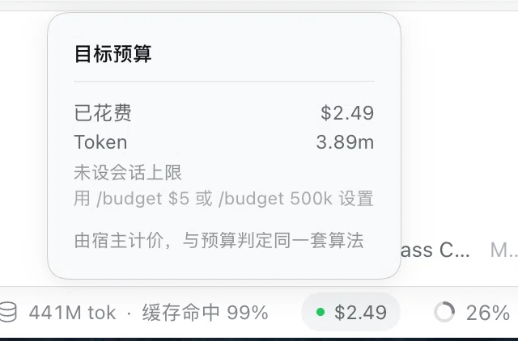

# dsh-goal-budget

> A resource budget gate for DeepSeek Harness goals. When the budget runs out it **blocks the goal** — it does not just show you a number.



<p align="center"><sub>Clicking the pill at the right of the composer opens the breakdown for this session. The figures are computed by the host, using the same math the gate does.</sub></p>

**Other languages:** [中文（默认）](README.md)

---

## Not another cost dashboard

There are already 40+ DSH plugins that report spend. Every one of them is **read-only**:

| Plugin | ⭐ | What it does |
| --- | --- | --- |
| `@kenz1117/dsh-ui-usage-billing` | 95 | usage billing **dashboard**, sidebar cost metrics |
| `dsh-mimo-quota` | 0 | usage and estimated-spend **views** from session event logs |
| `dsh-credits` | 3 | **track** provider balances, plan quotas, session costs |
| `dsh-composer-balance` | 0 | **display** account balance and estimated session cost |
| `dsh-web-api-balance` | 1 | **shows** API balance and this conversation's spend |

They answer **"how much did I spend?"**. This plugin answers **"should this keep running?"** — and acts on the answer.

```ts
ctx.goals.block(agent, { id, revision }, {
  code: 'budget-exceeded',
  message: 'Goal exceeded its configured tokens budget: 5200 / 100',
})
```

That difference is not cosmetic. A display can be wrong and you lose nothing. **An enforcement gate can be wrong and kill work that was about to succeed.** Different problem, different failure modes (see [Failure modes](#failure-modes)).

---

## Why this gap, specifically

Not a guess. The harness ships an automatic continuation driver, and its own README names three things it does *not* do:

> **Round cap, not resource budget** — token, currency, time, and provider quota policies remain independent. Their session events are **not attributed to the goal message** or **mapped into goal blocker codes**.
>
> — `packages/goal/goal-round-driver/README.md`, *Known Limitations and Deferred Work*

That sentence names three missing pieces. This plugin fills two of them:

| Named gap | Status |
| --- | --- |
| session events **not attributed to the goal message** | ✅ done here, keyed by `goalId` + `round` |
| not **mapped into goal blocker codes** | ✅ done here, `code: 'budget-exceeded'` |
| wall-clock budget | ✅ done (0.8.0), computed as the sum of turn spans - see "Time budget" below |

`GoalBlockReason.code` is an open `string` documented as *"chosen by the blocking policy"* — it exists so a policy plugin can name its own condition. Only two codes ship in-tree today (`model-reported`, `round-limit`). This adds `budget-exceeded`.

---

## Time budget

Besides tokens and cost, a goal can carry a **compute-time** cap:

```
/budget 30min          cap this session's compute time at 30 minutes
/budget $5 30min       cap both cost and time; whichever is reached first wins
```

Units: `s` (seconds) · `min` (minutes) · `h` (hours).

> **Why `min` and not `m`?** `m` already means "million tokens" (`1.5m` = 1.5 million). Giving one letter two meanings guarantees a typo, and the typo fails silently by setting an absurd cap.

### What it measures

**Compute time = the sum of turn spans.** Each turn runs from its `turn/start` to its last `turn/end`, and the whole interval counts.

This is **not** `now - goal creation`. The difference matters: a goal paused overnight would blow a 30-minute budget the next morning if you measured from creation, even though it only ran for a few minutes. Summing turn spans counts only the time the work was actually running.

The cost is that **idle time between turns is not counted.** A goal can run for three days and show 20 minutes of compute time. That is the right behaviour for a plugin that constrains compute, but read the figure with that meaning.

### Where the time comes from

Durations use only the timestamp each session event already carries (`SessionEvent.time`), never `Date.now()`. Replaying the same log yields the same number, so the gate and the projection measure the same thing.

### Current limits

- **Enforcement runs on the host.** Exceeding the cap blocks the goal and names the dimension that tripped.
- **The pill does not show time yet.** The projection carries tokens and cost; showing time in the pill needs a host-side extension point that does not exist yet. The `/budget` text output does show the elapsed time.

## Install

```sh
dsh plugin --profile desktop add github:boom-10/dsh-goal-budget
```

Then **restart DSH** — both halves of the plugin load at boot.

`dsh plugin` forwards to `pnpm` inside the profile directory, so a local path works too.

> When installing from a **local path**, pnpm warns that `peerDependencies` will not resolve from the target `node_modules`. **That warning is expected here**: `@deepseek-ai/cordis` and `@deepseek-ai/schemastery` are provided by the host at runtime. Use the `file:` protocol if it bothers you.

With no budget configured the plugin loads and idles, and `/budget` is how you set one.

---

## Usage

### 1. Set a budget from the chat box

No restart, no config file:

```
/budget            show the effective budget and what you have used
/budget $5         cap this session at 5 USD
/budget 500k       cap it at 500k tokens
/budget $5 500k    cap both; whichever is reached first wins
/budget off        drop the session override and fall back to the profile default
```

The budget is resolved as **session override ?? profile default**, so a fixed allowance can live in config and a one-off tightening costs one line in the composer.

### 2. Watch it on the pill

A pill appears in the composer's status bar, beside the host's own cache-hit and context readings:


<p align="center"><sub><code>● $2.50 / $5.00</code> in the status bar is this plugin - the host's own readings sit to its left, the context meter to its right.</sub></p>

Click it for the breakdown (built from the host's own primitives, so its look, keyboard reachability, and click-outside dismissal match the official pills):

```
┌──────────────────────────────┐
│ Goal budget              50% │
│ ──────────────────────────── │
│ Spent                  $2.50 │
│ Tokens                 3.90m │
│ Budget                 $5.00 │
│ Binding                 cost │
│ Priced by the host with the  │
│ same math the budget gate    │
│ uses                         │
└──────────────────────────────┘
```

**Two states**: with no cap the panel shows the "no session cap" hint instead of a percentage; once one is set, the percentage appears in the title row and the pill grows a progress bar — **amber at 80%, red at 100%** (the shot above is 50%, so it is still blue).

**Copy follows the DSH language setting** — the panel is translated, not hardcoded.

### 3. Or as a profile default

```yaml
- id: dsh-goal-budget
  config:
    budget:
      tokens: 2000000
      costUsd: 5.00
    onExceed: block        # or 'warn' to only log
    warnAtRatio: 0.8
    currency: auto                       # auto: detect via the DeepSeek balance endpoint (official route); write USD or CNY for a gateway
    deepseekCredentialRef: DEEPSEEK_API_KEY   # reference name of the key in the credentials service
    modelAliases: {}                     # map a renamed gateway model, e.g. cm-ais/deepseek-v5-flash: deepseek-flash
```

Why both layers: a budget is a **runtime decision** — it changes per session — while plugin config is a **deployment decision** read at boot. Putting the budget only in config forces a restart to change something you decide in the moment.

---

## How it works

### Attribution

Two facts make attribution possible, and only one event carries both.

```ts
// packages/core/session/src/types.ts:355 — spend lands here, keyed by turn
'assistant/message': { turn: number; step: number; usage?: TokenUsage; … }

// packages/core/agent/src/runtime-types.ts:328 — the ONLY event linking a message to a turn
'agent/inbox/claimed'(payload: { agent; message: UserMessage; turn: number }): void
```

`user/message` carries no `turn` — its payload is just a `UserMessage`. Sequencing alone would misread every `agent.inject()` context block as a new round. `agent/inbox/claimed` is the only event that pairs a message with the turn it opens, and `message.source` identifies automatic goal rounds:

```ts
source: { kind: 'goal', goalId, revision, round }   // round > 0 means an automatic round
```

So the chain is:

```
agent/inbox/claimed   source.kind === 'goal'  →  remember turn → { goalId, round }
        ↓
assistant/message     { turn, usage }         →  add to that goal's that round
        ↓
checkBudget()                                 →  over? → ctx.goals.block()
```

Attribution is **rebuilt from the session log**, never stored separately — restarting cannot double-count or reset.

### One number, one source

The pill does not compute cost. It reads it from the same projection the gate uses, so the number you see and the number that blocks can never disagree.

Pricing follows DSH's `TokenUsage` contract (`packages/llm/llm/src/types.ts:177`):

- `inputTokens` holds only **uncached** input; cache hits are reported separately in `cacheReadTokens`. The three buckets are disjoint, and billed input is their sum.
- `reasoningTokens` is a **subset** of `outputTokens` and is billed once, at the output price.

**This is an error I introduced.** In 0.5.0 I assumed `inputTokens` included cache hits and subtracted the cache from it. That under-counted uncached input, and the damage was largest in sessions with high cache-hit rates. The figures I had written earlier — "overstates by 2.7×" and "15%+ away" — were computed on that false assumption and have been removed. 0.8.1 corrects this and adds a regression test built from a real session's totals.

### Why `ctx.goals.block()` and not something else

It is the documented policy entry point, and it disarms continuation as part of the same call:

```ts
/**
 * Mark an active goal blocked and disarm it.
 * @param reason - policy-owned stable code and human-readable explanation.
 */
block(agent: Agent, ref: GoalRef, reason: GoalBlockReason): GoalView
```

### Mechanisms used

| Purpose | Mechanism | Why this one |
| --- | --- | --- |
| Read spend | `session/event` → `assistant/message` | Durable fact; replays across restarts. `agent/assistant-stream` is presentation data, not a replay source. |
| Attribute to a goal | `agent/inbox/claimed` | The only message↔turn link that exists. |
| Enforce | `ctx.goals.block()` | Documented policy entry point; disarms in the same call. |
| Configuration | `@deepseek-ai/schemastery` `Config` | The profile-level default; validated, not a constant. |
| Per-session control | `ctx.commands.register()` | Budgets are runtime decisions. Same mechanism the official `/goal` command uses. |
| Client data | `sessionProjections.register()` + a `wire` view | Folded from the log, so restarts, forks and excerpts are correct by construction; the client reads the same figure. |
| UI copy | `ctx.locale.register()` + `bind()` | The docs require it: product-authored client UI text must enter through dictionaries. |

---

## Rejected alternatives

**Using `agent/turn-stopping` to stop runaway turns.** Wrong granularity: a budget is a *goal*-level fact spanning many rounds, while `turn-stopping` is a turn-level hook with no cross-round view. Worse, blocking there leaves the goal `active`, so the continuation driver immediately opens another round — a deadlock, not a stop.

**Letting the model police itself via a tool.** The harness already notes the weakness of self-assessment (*"No independent evaluator — the model-facing goal policy decides when evidence is sufficient"*). Asking the constrained party to enforce its own constraint fails exactly when the budget is exhausted and judgment is worst — and it costs another model call *after* the budget is already gone.

**Building the 44th cost dashboard.** The ecosystem has that covered, and a dashboard cannot stop anything.

**Putting the budget only in plugin config.** The first version did, and it was wrong: config is read at boot, so changing a budget meant editing YAML and restarting — for a value you decide per session. A per-session budget needs a per-session surface, which is why `/budget` exists and config keeps only the default.

---

## Failure modes

Known, with current mitigation and what is still unsolved.

| # | Fails how | Looks like | Mitigation | Still open |
| --- | --- | --- | --- | --- |
| 1 | A turn mixes human and goal messages | human spend billed to the goal; premature block | Strict `source.kind === 'goal'` filter | Mixed-turn spend cannot be split cleanly; a warning records when it happens |
| 2 | Unit prices differ from billing | cost estimate off; wrong block point | DeepSeek official tariffs in two lists (USD and CNY), applied in the account currency; peak hours by Beijing time and the holiday calendar | official price changes need a manual update; a gateway route needs its currency set by hand; non-DeepSeek models are not priced yet |
| 3 | State rebuilt after restart | budget resets or doubles | Spend is recomputed from the session log only; nothing is stored separately | Session-format migrations may change field availability |
| 4 | Adapter reports no `usage` | spend silently uncounted | Marked **unattributable** and counted, never guessed; the block message reports the count | A provider that never reports usage **cannot be constrained at all** |
| 5 | Several goals in one session | spend billed to the wrong goal | Filtered by `goalId` | The boundary turn when goals are switched |
| 6 | Race with the continuation driver | a round starts after the block | `block()` disarms in the same call; ledgers cleared on dispose | A round already accepted but not yet run (the unload race the driver's README documents) |
| 7 | A ledger is registered in one structure but not the other | **attribution silently stops working** — no error | Both structures are maintained together and asserted by tests | None known |
| 8 | Startup log invisible at INFO level | plugin looks unloaded | Startup visibility uses `console.log`; alerts use `logger.warn` | Verbosity is not yet configurable |
| 9 | ~~`/budget` override is process-local~~ | ~~a restart returns the session to the profile default~~ | **Fixed**: the override lives in the `goalBudget` projection, folded from the `command/run` events the commands service already writes, so it is rebuilt from the log rather than remembered | — |
| 10 | A budget is blocking a goal, then raised | spend already over the old limit, but nothing re-checks | Setting or clearing a budget clears the blocked marker so the next step re-evaluates | A goal already `blocked` stays blocked until the operator resumes it |
| 11 | Client and host each compute cost | the number shown disagrees with the number that blocks | The host computes it into the projection; **the client only displays** | The client cannot read the profile default, so a denominator appears only when a session cap is set |
| 12 | Cache hits subtracted from input | uncached input under-counted; largest error in high-hit sessions | Fixed in 0.8.1: the three input buckets are priced disjointly; regression test uses a real session's totals | — |
| 13 | The host gate only sees request headers logged after the plugin loaded | after a restart with an unchanged model the gate gets no new header, treats usage as unpriced, and the cost gate fails silently | the panel's spend is rebuilt from the log and is unaffected | fixed in 0.9.2: the gate falls back to the projection's current route; regression test host-session-budget.spec.ts |
| 14 | The holiday calendar is out of date | a new year's holidays are treated as workdays and billed at peak, roughly double | at startup, warn if the current year is outside the calendar | run scripts/build-holidays.py each year |
| 15 | The account currency cannot be detected | the balance endpoint fails, or the account holds two currencies | cost is withheld with a note rather than guessed; set currency in the config | a gateway route does not use the DeepSeek balance endpoint, so its currency must be set |
| 16 | Listeners were skipped when the profile set no default budget | a session that set its budget only with /budget reported success and showed numbers in the pill, yet nothing was ever accounted, so warn and block never fired - it looked healthy | - | fixed in 0.9.2: listeners register unconditionally, since a budget can be added at any time |
| 17 | Attribution matched turn numbers across sessions | with two sessions running, turn numbers repeat, so session B's usage was charged to session A's goal; A could block early and B never saw its own usage | - | fixed in 0.9.2: ownership is keyed by (session, turn); without a session the usage is not attributed |

Number 7 is the one to watch: it fails *silently*. So does number 8. Both were found by testing behaviour rather than checking for absence of errors — the same shape as the harness's own post-mortem 0001, where 178 green tests and 100% line coverage coexisted with a completely non-functional feature.

### Cache pricing

A cache hit costs about 1/50 of an uncached input token (off-peak: $0.003 against $0.15). In a high-hit session it is still a large share of the bill: one real session had about 651M cache-hit tokens against 13.2M uncached input tokens, and with the three buckets priced disjointly, cache hits and uncached input each account for about 45% of the cost. Pricing a cache hit at the uncached rate overstates that portion about 50×.

### Currency, tariffs and peak hours

- **Currency follows the account, not the interface language.** On the official DeepSeek route the plugin calls the balance endpoint `GET /user/balance` once at startup with your API key and reads `balance_infos[].currency` (`CNY` or `USD`). The key comes from DSH's credentials service (reference name in `deepseekCredentialRef`); it is never written to the plugin or to logs. On a gateway route (for example AIS / Compass) the balance endpoint may not be available; set `currency` to `USD` or `CNY` directly.
- **Tariffs are DeepSeek's official ones, in two separate lists.** The USD prices come from the English pricing page and the CNY prices from the Chinese one. They are published as separate numbers, not converted from each other. Both lists have off-peak and peak rates; the peak rate is twice the off-peak rate.
- **Peak hours follow Beijing time.** Monday to Friday, 09:00–12:00 and 14:00–18:00 are peak. Weekends and Chinese public holidays are off-peak all day. Holidays come from holiday-cn (MIT, pinned version, see `THIRD_PARTY/holiday-cn-LICENSE`), currently covering 2025 and 2026.
- **A gateway prefix is stripped automatically.** A model id like `cm-ais/deepseek-v4.1-flash` matches the built-in tariff after the `vendor/` prefix is removed; a renamed model needs one `modelAliases` line rather than a plugin release.
- **Legacy model names fold to their current price.** `deepseek-v4-flash` and `deepseek-v4-flash-vision-exp` are billed at the Flash price, as the official page states.
- **A model without a price is not guessed.** Only DeepSeek is priced for now. Other models' tokens are counted, their cost is not, and the panel lists their names.
- **No exchange rate.** Costs are computed in the account's currency and budgets are set in it: `/budget $5` for a USD account, `/budget ¥30` for a CNY account. A cost cap in the wrong currency is rejected.

### Verifying against a real session log

The unit tests use synthetic events; `scripts/replay.ts` replays a log your machine actually produced:

```sh
# Session logs are zstd-compressed (system Python 3.14+ decompresses them)
python3 -c "from compression import zstd, pathlib; p = pathlib.Path('<session dir>/session.jsonl.zstd'); pathlib.Path('/tmp/s.jsonl').write_bytes(zstd.decompress(p.read_bytes()))"
node --experimental-strip-types scripts/replay.ts /tmp/s.jsonl USD
```

One real session (42,074 events, 1,715 usage records, 3 routes) replays to:

| Metric | Value |
|---|---|
| Total tokens | 665,090,129 (identical to DSH's own projection cache) |
| Cost | $6.6252 · ¥44.1681 |
| Peak-hour usage | 418,573,609 tokens (about 64%, billed at 2x) |
| Unpriced model | `ais/llm-gateway--kimi-k3` (not DeepSeek; 11,044,122 tokens left unpriced) |

This replay caught a bug the synthetic tests missed: the gateway separates with `--` (`ais/llm-gateway--deepseek-v4-flash`), while the plugin only stripped a `vendor/` prefix, so **the whole session priced at $0**. After the fix it is $6.6252; the gap from the flat off-peak estimate of $4.35 in 0.8.1 is exactly the peak-hours share billed at 2x.

---

## Development

```sh
npm run typecheck   # tsc
npm test            # 11 specs; no API key needed
npm run build       # esbuild bundle → lib/index.js
```

The suite is checked by mutation, not just by passing: reintroducing either pricing bug, dropping the `nullable()` a wire view needs, or reverting the panel's portal turns it red. Several of those mutations originally survived — the tests had never exercised a `k` suffix, a non-zero `cacheReadTokens`, or a hardcoded label — which is how the extra cases came to exist.

11 specs, each guarding one thing:

| Spec | Covers |
| --- | --- |
| `loader.spec.ts` | export shape, through the real `unwrapExports` semantics |
| `budget-command.spec.ts` | the `/budget` handler; a session override **actually changes the blocking threshold**; clearing stops blocking; one goal is never blocked twice |
| `budget-currency.spec.ts` | CNY amount forms (`¥30`, `30元`, `cny30`), symbol rendering, and "the amount may be written once" |
| `accounting.spec.ts` | the arithmetic: three disjoint input buckets, cache writes at the miss rate, reasoning not billed twice, both directions of "whichever is reached first wins" |
| `tariff.spec.ts` | the official tariffs and peak windows: Beijing-time boundaries, weekends and public holidays, model aliases and gateway prefixes, a real session's amounts |
| `currency-detect.spec.ts` | account-currency detection: CNY / USD / both / empty / non-2xx, and that the error text never contains the key |
| `projection-view.spec.ts` | the projection's `wire` view passes its own `viewSchema` (the 0.4.0 incident); currency decides the amount, an unknown currency is not faked, unpriced models are named |
| `host-currency.spec.ts` | host level: `/budget` rejects a cost cap in the wrong currency |
| `host-session-budget.spec.ts` | host level: **with no profile default, a `/budget`-only session still accounts and blocks**; route fallback; no double block; no fabricated cost without a route |
| `wallclock.spec.ts` | the time dimension: unit parsing, summed turn spans, idle time across days excluded, budget verdicts |
| `client-pill.spec.ts` | the browser half: reads the right level, portals, opens on click, takes its copy from the dictionary, and notes unpriced models or an unknown currency |

### Two things worth calling out

**`loader.spec.ts` drives the real load path rather than mounting the plugin by hand**, because a hand-mounted test cannot validate how a plugin loads. It asserts that no `export default` is present: a default export makes the loader resolve to a bare `apply` function, discarding the sibling `inject`/`name`/`Config` exports, so the fiber is built with an empty `inject` and the plugin crashes on first service access.

**The ambient type file is the dependency manifest.** Types for the harness APIs this plugin uses live in [`types/dsh-ambient.d.ts`](types/dsh-ambient.d.ts), each annotated with its source file and line. It is the complete list of harness surface this plugin touches, and it costs no install.

---

## License

MIT
