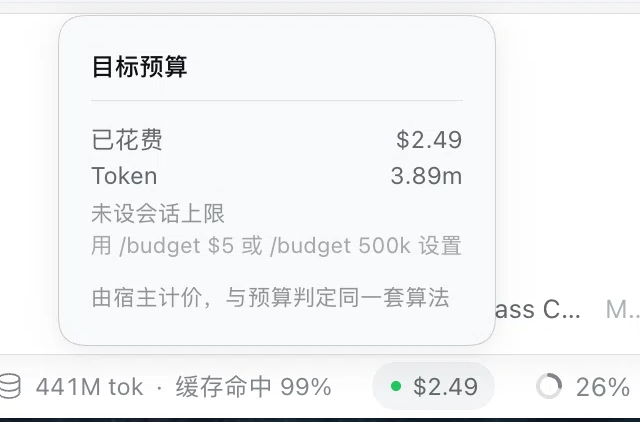

# dsh-goal-budget

> 给 DSH 的长任务目标设一个 token / 费用上限。**超了就把它停下** —— 不是只给你看个数字。



<p align="center"><sub>点开输入框右下角的 pill，是本会话的花费明细。数据由宿主计算，与阻断判定同源。</sub></p>

**其他语言 / Other languages:** [English](README.en.md)

---

## 一句话说清它和别的插件的区别

DSH 生态里已经有 40+ 个插件能告诉你 **「我花了多少钱」**。
这个插件回答的是 **「这个目标还该不该继续跑」** —— 并且**对答案采取行动**。

```ts
ctx.goals.block(agent, { id, revision }, {
  code: 'budget-exceeded',
  message: '目标超出配置的 token 预算：5200 / 100',
})
```

**这个区别不是修辞。** 一个显示错了你只是看到个错数字；**一个执行的闸门错了，会杀掉本来就要成功的工作。** 不同的问题，不同的失败模式（见 [失败模式](#失败模式)）。

---

## 为什么这个缺口是真实存在的

不是猜的。DSH 自带目标自动续跑驱动，**它自己的 README 就点名了三件它不做的事**：

> **Round cap, not resource budget** — token, currency, time, and provider quota policies remain independent. Their session events are **not attributed to the goal message** or **mapped into goal blocker codes**.
>
> — `packages/goal/goal-round-driver/README.md`，*Known Limitations and Deferred Work*

这句话点了三块缺失。这个插件补了其中两块：

| 官方点名的缺口 | 状态 |
| --- | --- |
| 会话事件**没有归因到目标消息** | ✅ 已做，按 `goalId` + `round` 归因 |
| 没有**映射成目标的阻断码** | ✅ 已做，`code: 'budget-exceeded'` |
| 墙钟时间预算 | ✅ 已做（0.8.0），计算时间 = 各轮跨度之和，见下文「时间预算」 |

`GoalBlockReason.code` 是一个开放的 `string`，官方文档说它由 *"the blocking policy"* 决定 —— **它存在就是为了让策略插件给自己的条件命名**。目前树内只随附两个码（`model-reported`、`round-limit`），这里补上第三个。

---

## 时间预算

除了 token 和费用，还可以给一个目标设**计算时间**上限：

```
/budget 30min          本会话计算时间上限 30 分钟
/budget $5 30min       费用和时间两个都设，谁先到算谁
```

支持的单位：`s`（秒）· `min`（分钟）· `h`（小时）。

> **为什么分钟写 `min` 而不是 `m`？** `m` 已经表示「百万 token」（`1.5m` = 150 万）。让同一个字母两种含义，用户一定会写错，而且错了不会报错，只会安静地设成一个荒谬的上限。

### 它量的是什么

**计算时间 = 各轮跨度之和。** 每一轮从它的 `turn/start` 开始，到最后一个 `turn/end` 结束，中间的时间全部计入。

这**不是** `now - 目标创建时间`。区别很重要：一个目标暂停一整夜，第二天恢复时，如果用创建时间算，30 分钟的预算会立刻爆掉 —— 而它实际只跑了几分钟。各轮跨度之和只计真正在跑的时间。

代价是：**轮与轮之间的空闲不计入。** 一个目标可以跑了三天，但计算时间只有 20 分钟。对一个约束计算的插件来说这是对的，但请按这个含义理解它。

### 时间从哪来

时长只用会话事件自带的时间戳（`SessionEvent.time`），不用 `Date.now()`。这样重放同一份日志得到同一个数，阻断判定和投影算的是同一件事。

### 当前的边界

- **阻断判定在宿主侧生效**，超时会阻断目标并写明是哪一维超了。
- **pill 上暂时不显示时间**。投影目前只携带 token 和费用；时间的显示需要一个宿主侧的扩展点，还没有。`/budget` 的文字输出会显示已用时长。

## 安装

```sh
dsh plugin --profile desktop add github:boom-10/dsh-goal-budget
```

装完**重启 DSH**（插件的宿主半边和客户端半边都在启动时加载）。

`dsh plugin` 会把参数转发给 profile 目录里的 `pnpm`，所以 git 引用、本地路径都能用。

> **从本地路径安装时**，pnpm 会警告 `peerDependencies` 无法从目标 `node_modules` 解析。**这个警告在这里是预期的** —— `@deepseek-ai/cordis` 和 `@deepseek-ai/schemastery` 由宿主在运行时提供。介意的话用 `file:` 协议。

**不配任何预算也能装** —— 插件会加载并空转，等你用 `/budget` 设一个。

---

## 用法

### 一、在会话里设上限

**在输入框直接打命令，不用改 YAML、不用重启：**

```
/budget            查看当前生效的上限和已用量
/budget $5         本会话费用上限 5 美元
/budget 500k       本会话 token 上限 50 万
/budget $5 500k    两个都设，谁先到算谁
/budget off        清掉会话覆盖，回到 profile 默认
```

预算按 **会话覆盖 ?? profile 默认** 解析 —— 所以「固定的额度」可以写在配置里，「临时收紧一次」只要在输入框打一行。

### 二、在 pill 上看进度

装好后，输入框右下角的状态条里会多出一个 pill —— 就在宿主自己的「缓存命中」「上下文占用」旁边：


<p align="center"><sub>状态条里的 <code>● $2.50 / $5.00</code> 就是本插件 —— 左边是宿主自己的指标，右边是上下文占用。</sub></p>

点它，展开明细（走宿主的原语，所以外观、键盘可达性、点击外部关闭都和官方 pill 一致）：

```
┌──────────────────────────────┐
│ 目标预算                 50% │
│ ──────────────────────────── │
│ 已花费                 $2.50 │
│ Token                  3.90m │
│ 上限                   $5.00 │
│ 先到                    费用 │
│ 由宿主计价，与预算判定同一套算法 │
└──────────────────────────────┘
```

**两种状态**：没设上限时，面板显示的是「未设会话上限 + 怎么设」而不是百分比；设了之后，标题栏右侧出现使用百分比，pill 上也长出进度条 —— **到 80% 转琥珀，100% 转红**（上图是 50%，所以还是蓝色）。

**文案跟随 DSH 的语言设置** —— 界面是中文，pill 就是中文。

### 三、或者作为 profile 默认

想给所有会话一个固定额度：

```yaml
- id: dsh-goal-budget
  config:
    budget:
      tokens: 2000000
      costUsd: 5.00
    onExceed: block        # 或 'warn'，只记日志不阻断
    warnAtRatio: 0.8
    currency: auto                       # auto：用 DeepSeek 余额接口识别（官方线路）；网关线路写 USD 或 CNY
    deepseekCredentialRef: DEEPSEEK_API_KEY   # 凭据服务里的 Key 引用名
    modelAliases: {}                     # 网关给模型改名时映射，例如 cm-ais/deepseek-v5-flash: deepseek-flash
    peakPricing: false                   # 官方线路 true；网关按固定单价计费时 false（否则高峰时段高估一倍）
```

**为什么坚持做两层：** 预算是**运行时决策**（每个会话都可能不同），而插件配置是**部署决策**（启动时读取）。把预算只放在配置里，意味着为了改一个你当场决定的值要重启应用。

---

## 和已有的用量插件有什么不同

生态里报告花费的插件已经饱和了，而且**全是只读的**：

| 插件 | ⭐ | 它做什么 |
| --- | --- | --- |
| `@kenz1117/dsh-ui-usage-billing` | 95 | 用量账单**看板**、侧边栏成本指标 |
| `dsh-mimo-quota` | 0 | 从会话事件日志**查看**用量与估算花费 |
| `dsh-credits` | 3 | **跟踪**供应商余额、套餐额度、会话成本 |
| `dsh-composer-balance` | 0 | **显示**账户余额与本会话估算成本 |
| `dsh-web-api-balance` | 1 | **展示** API 余额与本次对话花费 |

**它们回答「我花了多少」。这个插件回答「该不该继续」——并且执行这个答案。**

---

## 设计

### 花费怎么归因到目标

有两个事实让归因成为可能，而**只有一个事件同时携带两者**：

```ts
// packages/core/session/src/types.ts:355 —— 花费落在这里，按 turn 索引
'assistant/message': { turn: number; step: number; usage?: TokenUsage; … }

// packages/core/agent/src/runtime-types.ts:328 —— 唯一把消息和 turn 连起来的事件
'agent/inbox/claimed'(payload: { agent; message: UserMessage; turn: number }): void
```

**`user/message` 不携带 `turn`** —— 它的载荷只是一个 `UserMessage`。光靠事件顺序会把每个 `agent.inject()` 的上下文块都误读成一"轮"。`agent/inbox/claimed` 是**唯一**把消息和它所开启的 turn 配对的事件，而 `message.source` 能识别自动续跑：

```ts
source: { kind: 'goal', goalId, revision, round }   // round > 0 = 自动续跑的轮次
```

所以链条是：

```
agent/inbox/claimed   source.kind === 'goal'  →  记住 turn → { goalId, round }
        ↓
assistant/message     { turn, usage }         →  累加到该目标的该轮
        ↓
checkBudget()                                 →  超了？→ ctx.goals.block()
```

归因**完全从会话日志重建**，从不另存一份 —— 所以重启不会重复计费，也不会清零。

### 一个数字，一个来源

pill 不自己算钱。它读的是**闸门用的同一个投影**，所以你看到的数和阻断判定用的数**不可能分歧**。

计价口径以 DSH 的 `TokenUsage` 契约为准（`packages/llm/llm/src/types.ts:177`）：

- `inputTokens` 只含**未命中缓存**的输入；缓存命中单独记在 `cacheReadTokens`。三者并列，计费输入是三者之和。
- `reasoningTokens` 是 `outputTokens` 的**子集**，按输出价计一次，不再重复加。

**这里有一个我引入的错误。** 0.5.0 时我误以为 `inputTokens` 包含缓存命中，于是从输入里扣掉了缓存。这让未命中的输入被低估，在缓存命中率高的会话里偏差最大。前面文档里「高估 2.7 倍」「偏差 15%」之类的数字都是在这个错误假设上算的，已经删除。0.8.1 修正了这一点，并用一个真实会话的合计做了回归测试。

### 为什么用 `ctx.goals.block()`

它是官方文档指定的策略入口，而且**在同一次调用里就解除了续跑**：

```ts
/**
 * Mark an active goal blocked and disarm it.
 * @param reason - policy-owned stable code and human-readable explanation.
 */
block(agent: Agent, ref: GoalRef, reason: GoalBlockReason): GoalView
```

### 用到的机制

| 目的 | 机制 | 为什么选它 |
| --- | --- | --- |
| 读花费 | `session/event` → `assistant/message` | 持久事实；重启后可重放。`agent/assistant-stream` 是呈现数据，不是重放源 |
| 归因到目标 | `agent/inbox/claimed` | 唯一存在的 消息↔turn 链接 |
| 执行 | `ctx.goals.block()` | 官方策略入口；同一次调用里解除续跑 |
| 配置 | `@deepseek-ai/schemastery` 的 `Config` | profile 级默认值；经过校验，不是常量 |
| 会话内控制 | `ctx.commands.register()` | 预算是运行时决策。官方 `/goal` 命令用的同一套机制 |
| 客户端数据 | `sessionProjections.register()` + `wire` 视图 | 从日志 fold，重启/分叉/摘录自动正确；客户端读同一个数 |
| UI 文案 | `ctx.locale.register()` + `bind()` | 官方硬要求：客户端 UI 文案必须走字典 |

---

## 被否掉的方案

**用 `agent/turn-stopping` 拦停失控的 turn。**
**粒度错了**：预算是**目标级**的事实、横跨多轮，而 `turn-stopping` 是轮级钩子、没有跨轮视野。更糟的是在那里阻断会让目标保持 `active`，续跑驱动立刻又开一轮 —— **那是死锁，不是停止**。

**让模型用工具自己管自己。**
框架自己的文档就指出了自我评估的弱点（*"No independent evaluator — the model-facing goal policy decides when evidence is sufficient"*）。**让被约束方执行对自己的约束，恰好在预算耗尽、判断力最差的时候失效** —— 而且它还要在预算已经花完之后再花一次模型调用。

**做第 44 个成本看板。**
生态已经覆盖了，而且看板拦不住任何东西。

**把预算只放在插件配置里。**
第一版就是这么做的，错了：配置在启动时读取，所以改预算要改 YAML + 重启 —— 而那是你当场决定的值。**会话级的预算需要会话级的界面**，这就是 `/budget` 存在的原因，配置只留默认值。

---

## 失败模式

已知的，连同当前的缓解手段和仍未解决的问题。

| # | 怎么坏 | 表现 | 缓解 | 仍未解决 |
| --- | --- | --- | --- | --- |
| 1 | 一轮里混有人类消息和目标消息 | 人类的消费被记到目标上；过早阻断 | 严格过滤 `source.kind === 'goal'` | 混合轮的花费无法干净拆分；发生时记一条警告 |
| 2 | 单价与实际计费不同 | 成本估算偏移；阻断点错误 | DeepSeek 官方价目（美元与人民币两套），按账户币种计价；峰谷按北京时间窗口与法定节假日日历 | 官方调价需人工更新价目；网关线路需手动指定币种；非 DeepSeek 模型暂不计价 |
| 3 | 重启后重建状态 | 预算重置或翻倍 | 花费只从会话日志重算，不另存 | 会话格式迁移可能改变字段可用性 |
| 4 | 适配器不上报 `usage` | 花费**静默**未计入 | 标记为**不可归因**并计数，**从不猜**；阻断信息里报告条数 | **完全不上报 usage 的供应商根本无法约束** |
| 5 | 一个会话里有多个目标 | 花费记到错的目标上 | 按 `goalId` 过滤 | 切换目标时的边界轮次 |
| 6 | 与续跑驱动竞争 | 阻断之后还是开了一轮 | `block()` 在同一次调用里解除续跑；dispose 时清账本 | 已被接受但尚未执行的轮次（驱动 README 里记录的卸载竞争） |
| 7 | 账本注册在一个结构里但没注册在另一个 | **归因静默失效** —— 不报错 | 两个结构一起维护，并有测试断言 | 未知 |
| 8 | INFO 级别下启动日志不可见 | 插件看起来没加载 | 启动可见性用 `console.log`；告警用 `logger.warn` | 详细程度尚不可配 |
| 9 | ~~`/budget` 覆盖是进程内的~~ | ~~重启后回到 profile 默认~~ | **已修**：覆盖活在 `goalBudget` 投影里，从命令服务本来就会写的 `command/run` 事件 fold 出来 —— 是重建的，不是记住的 | — |
| 10 | 目标已被阻断，然后调高预算 | 花费仍超旧限额，但没人重新检查 | 设置或清除预算时会清掉阻断标记，下一步重新判定 | 已经 `blocked` 的目标需要操作者手动恢复 |
| 11 | 客户端与宿主各算一套成本 | 看到的数和阻断的数不一致 | 花费由宿主算好放进投影，**客户端只显示** | 客户端读不到 profile 默认值，所以只有设了会话上限才显示分母 |
| 12 | 把缓存命中从输入里扣掉 | 未命中输入被低估，缓存率高的会话偏差最大 | 已修（0.8.1）：三个输入桶并列计价，不再扣减；用真实会话合计做回归测试 | — |
| 13 | 宿主门禁只看插件加载后的请求头 | 重启后若会话的模型没变，门禁收不到新的请求头，用量被当成不计价，费用闸门静默失效 | 面板的花费由日志重建，不受影响 | 已修（0.9.2）：门禁在收不到请求头时从投影读当前路由；回归测试 host-session-budget.spec.ts |
| 14 | 节假日日历过期 | 新年度的假期被当成工作日，按高峰计价，多算一倍 | 启动时检查当前年份是否在日历覆盖范围内，不在则告警 | 每年运行 scripts/build-holidays.py 更新 |
| 15 | 账户币种无法识别 | 余额接口失败，或账户同时有两种币种 | 识别失败时费用暂不计入并显示说明，不猜；可在配置里直接指定 currency | 网关线路不走 DeepSeek 余额接口，必须手动指定 |
| 16 | 无 profile 默认预算时跳过监听器注册 | 只用 /budget 设置预算的会话：命令成功、pill 有数字，但用量完全没记账，预警与阻断永不触发 —— 看起来一切正常 | —— | 已修（0.9.2）：监听器无条件注册，因为预算可以在运行时随时加上 |
| 17 | 归属按 turn 号跨会话匹配 | 两个会话同时进行时 turn 号重复，B 会话的花费被记到 A 会话的目标上，可能阻断错的目标，B 自己的预算永远看不到自己的用量 | —— | 已修（0.9.2）：归属按「会话 + turn」隔离；拿不到会话就不归因 |
| 18 | 把网关当成官方峰谷计价 | 网关按固定单价计费时，高峰时段的费用高估一倍 | —— | 已修（0.9.3）：新增 `peakPricing`；实测网关应为 `false` |

**第 7 条是要盯着的那条：它失败时*没有声音*。第 8 条也是。**

两条都是靠**测行为**而不是**检查有没有报错**发现的 —— 和框架自己的 post-mortem 0001 同一个形状：那里 178 个绿灯测试和 100% 行覆盖，与一个完全不能用的功能同时存在。

### 缓存计价

缓存命中的单价约为未命中价的 1/50（非高峰：$0.003 对 $0.15）。在缓存命中率高的会话里，它仍占很大一部分花费：一个真实会话有约 6.5 亿缓存命中与 1300 万未命中输入，三桶并列计价后，缓存命中与未命中输入各约占 45%。把缓存命中按未命中价计费，缓存部分的成本会高估约 50 倍，所以它必须单独计价。

### 币种、价目与峰谷时段

- **币种按账户决定，不按界面语言。** DeepSeek 官方线路：启动时用你的 API Key 调余额接口 `GET /user/balance`，读取 `balance_infos[].currency`（`CNY` 或 `USD`）自动识别。Key 从 DSH 的凭据服务读取（引用名见 `deepseekCredentialRef`），不写进插件，也不写日志。网关线路（如 AIS / Compass）的余额接口不一定可用，请在 `currency` 里直接写 `USD` 或 `CNY`。
- **价目是 DeepSeek 官方的，美元与人民币两套分开。** 美元价来自英文官方页面，人民币价来自中文官方页面，是各自公布的数字，不是汇率换算的结果。两者都有空闲价与高峰价，高峰价是空闲价的 2 倍。
- **峰谷时段按北京时间。** 周一至周五 9:00–12:00、14:00–18:00 为高峰；周末与法定节假日全天为空闲。节假日来自 holiday-cn（MIT 许可，固定版本，见 `THIRD_PARTY/holiday-cn-LICENSE`），目前覆盖 2025 和 2026 年。
- **网关前缀自动去掉。** 模型 id 形如 `cm-ais/deepseek-v4.1-flash` 时，会先去掉 `供应商/` 前缀再匹配内置价目；改名过的模型用 `modelAliases` 映射一条即可，不必等插件发版。
- **旧模型名按官方说明折叠。** `deepseek-v4-flash` 与 `deepseek-v4-flash-vision-exp` 按 Flash 价格计费。
- **不计价的模型不猜。** 目前只支持 DeepSeek；其它模型的 token 照常计入，费用不计，并在面板里列出它的名字。
- **面板按模型分列明细**：每个模型各占多少 token、算了多少钱（或标为「未计价」），一眼能看出哪部分没计入。
- **没有汇率。** 费用按账户币种直接算，预算也按账户币种设：美元账户用 `/budget $5`，人民币账户用 `/budget ¥30`。币种不符的费用上限会被拒绝。

### 用真实会话日志回放验证

单元测试用的是合成事件；`scripts/replay.ts` 用的是你机器上真实跑过的日志：

```sh
# 会话日志是 zstd 压缩的（系统 Python 3.14+ 自带解压）
python3 -c "from compression import zstd, pathlib; p = pathlib.Path('<会话目录>/session.jsonl.zstd'); pathlib.Path('/tmp/s.jsonl').write_bytes(zstd.decompress(p.read_bytes()))"
node --experimental-strip-types scripts/replay.ts /tmp/s.jsonl USD
```

一个真实会话（42,074 条事件 · 1,715 条用量 · 3 条路由）的回放结果：

| 指标 | 值 |
|---|---|
| token 合计 | 665,090,129（与 DSH 自己的投影缓存逐位一致） |
| 费用 | $6.6252 · ¥44.1681 |
| 高峰时段用量 | 418,573,609 token（约占 64%，按 2 倍计价） |
| 不计价的模型 | `ais/llm-gateway--kimi-k3`（非 DeepSeek，11,044,122 token 未计价） |

这个回放抓到一个合成测试漏掉的 bug：网关用 `--` 作分隔符（`ais/llm-gateway--deepseek-v4-flash`），而插件原先只认 `供应商/` 前缀，导致**整段会话费用算成 $0**。

同一批 DeepSeek 用量（654,046,007 token）在两种口径下的对比：**全按非高峰 $4.1893，按官方峰谷 $6.6252** —— 差的 58% 正是高峰时段按 2 倍计价的部分。

⚠️ 不要拿「全量 token × Flash 价」得到的 $4.3537 来和 $6.6252 比：**两者分母不同**。$4.3537 把非 DeepSeek 路由的 11,044,122 token 也按 Flash 价算了（多算约 $0.1644），而那部分插件是**不计价**的（列在「未计价」里）。

### 用网关账单校准

网关暴露了用量与费用接口，可以直接拿真实账单核对插件的单价：

```sh
curl -s "http://127.0.0.1:3425/v1/magpie/usage/requests?model=deepseek-flash&limit=200" \
  -H "Authorization: Bearer $MAGPIE_GATEWAY_KEY"
```

用 **197 条真实记录**核对的结果：

| 假设 | 197 条记录的总绝对误差 |
| --- | --- |
| 全时段按非高峰价 | **0.0000000000**（逐条精确吻合） |
| 高峰按 2 倍 | 0.2373034560（正好等于这批记录的总金额） |

两条结论，都改变了实现：

1. **单价 0.15 / 0.003 / 0.6（每百万美元）是准的** —— 与官方非高峰价逐条吻合到 1e-10。
2. **该网关按固定单价计费，不分峰谷** —— 这 197 条全部落在高峰时段，收费却是非高峰价。所以加了 `peakPricing` 配置：官方线路保持 `true`，网关线路设 `false`。**设错的代价是高峰时段高估一倍。**

同一个会话（9,958 条事件）在两种口径下的对比：

| 口径 | DeepSeek 部分费用 |
| --- | --- |
| `official`（官方峰谷） | $5.2357 |
| `flat`（网关固定价） | **$3.1806** |

顺带一个发现：网关对 DSH 实际使用的 `cm-ais/deepseek-v4.1-flash` 报 **unpriced**（6,643 次调用、费用记 0）——它的价格表里没有这个模型 id。也就是说这部分消费**在网关自己的账单里看不到金额**，正是本插件补上的缺口。

### 给 DeepSeek 之外的模型配单价

内置价目只有官方 DeepSeek。其它模型（网关、中转站、别家模型）在这里配：

```yaml
modelPrices:
  - model: gpt-6.1-sol        # 匹配规则与别名相同：去掉 `供应商/` 前缀、忽略大小写
    currency: USD
    inputPerMillion: 2
    cacheReadPerMillion: 0.1
    cacheWritePerMillion: 2
    outputPerMillion: 10
    estimated: false          # 单价是估算时设 true，面板会用 ≈ 标出
```

**别抄价目表，抄账单。** `scripts/calibrate-prices.py` 从供应商自己的逐条计费记录里解出这四个单价，并用残差验证：

```sh
# 反解：能解的解开，token 太少而不可解的明确标出，不编造
python3 scripts/calibrate-prices.py --agent dsh
# 验证：给定一组候选单价，逐条核对是否与账单精确一致
python3 scripts/calibrate-prices.py --verify --model claude-haiku-5-5 \
  --rates in=0.5,cache_read=0.05,cache_write=0.625,out=2.5
```

实测结论（同一台网关）：

| 模型 | 结果 |
| --- | --- |
| `gpt-6.1-sol` | 504 条记录**逐条精确**：2 / 0.1 / 10 |
| `claude-sonnet-5-5` | 600 条记录精确解出：2 / 0.1 / 2.5 / 10 |
| `claude-haiku-5-5` | 大多数请求与 0.5 / 0.05 / 0.625 / 2.5 精确一致，但**有一部分请求恰好按 1/5 计费**（比值 0.200 —— 路由命中了更便宜的上游） |

最后一行的含义很重要：**同一模型、同一上游凭据，供应商仍可能按请求变价**，而会话日志里看不到这个维度。所以这类单价要标 `estimated: true`，面板用 `≈` 显示并写明原因 —— 比给一个看起来精确的数字更诚实。目前只有 DeepSeek 的价目是**逐条核实过**的（197 条记录，误差 0）。

---

## 开发

```sh
npm run typecheck   # tsc
npm test            # 11 个 spec，不需要 API key
npm run build       # esbuild 打包 → lib/index.js
```

**测试套件是用变异检验的，不只是"跑绿"。** 把任何一个计价 bug 放回去、或者去掉 wire 视图需要的 `nullable()`，套件都会变红。

其中两个变异**最初是漏网的** —— 测试从没喂过 `k` 后缀，也从没喂过非零的 `cacheReadTokens`。`test/accounting.spec.ts` 和 `budget-command.spec.ts` 里的后缀用例就是这么来的。

11 个 spec 各管一件事：

| Spec | 管什么 |
| --- | --- |
| `loader.spec.ts` | 导出形状（走真实的 `unwrapExports` 语义）|
| `budget-command.spec.ts` | `/budget` 处理器；**会话覆盖真的改变了阻断阈值**；清除后不再误触发；一个目标不会被阻断两次 |
| `budget-currency.spec.ts` | 人民币金额的写法（`¥30` · `30元` · `cny30`）、符号显示、「金额只能写一次」 |
| `accounting.spec.ts` | 计价的会计部分：三个输入桶并列、缓存写入按未命中价、推理不重复计费、「谁先到算谁」 |
| `tariff.spec.ts` | 官方价目与峰谷：北京时间窗口边界、周末与法定节假日、模型别名与网关前缀、真实会话的金额 |
| `currency-detect.spec.ts` | 账户币种识别：人民币 / 美元 / 两种并存 / 空余额 / 非 2xx；错误信息不含 API Key |
| `projection-view.spec.ts` | 投影的 `wire` 视图能通过它自己的 `viewSchema`（**0.4.0 的事故**）；币种决定金额、币种未知不伪造、不计价的模型被列出 |
| `host-currency.spec.ts` | 宿主级：币种不符的费用上限被 `/budget` 拒绝 |
| `host-session-budget.spec.ts` | 宿主级：**profile 无默认预算、仅用 `/budget` 时也能记账并阻断**；路由回退；不重复阻断；无路由时不伪造费用 |
| `wallclock.spec.ts` | 时间维度：单位解析、各轮跨度求和、跨天的空闲不计入、预算判定 |
| `client-pill.spec.ts` | 浏览器半边：读对层级、走 portal、点得开、文案走字典、未计价模型与币种未知的提示 |

### 两件值得单独说的事

**`loader.spec.ts` 驱动真实的加载路径，而不是手工挂载插件。** 因为手工挂载**验证不了插件怎么加载**。它断言没有 `export default` —— 一个 default 导出会让 loader 解析成一个裸的 `apply` 函数，丢掉旁边的 `inject`/`name`/`Config`，于是 fiber 用空的 `inject` 构建，插件在第一次访问服务时崩溃。

**类型声明即依赖清单。** 这个插件用到的 DSH API 类型都在 [`types/dsh-ambient.d.ts`](types/dsh-ambient.d.ts)，**每一条都标了出处文件和行号**。那个文件同时就是完整的依赖面清单，而且零安装成本。

---

## License

MIT
